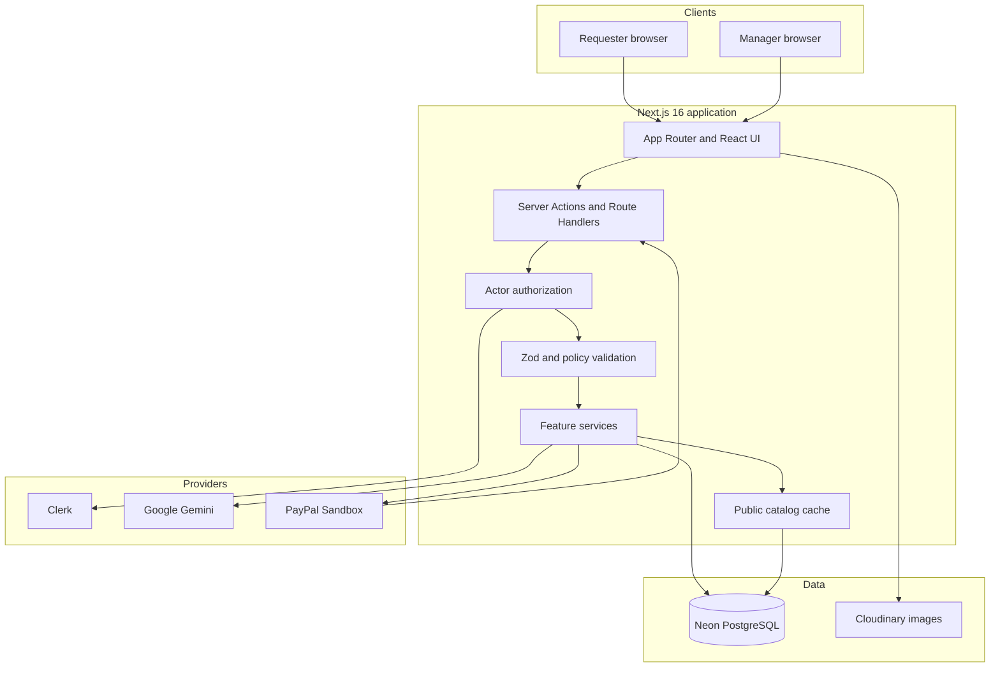
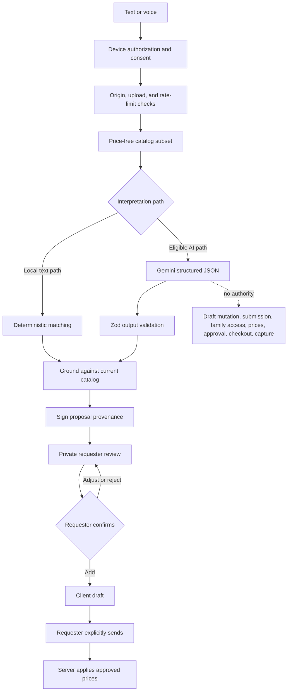
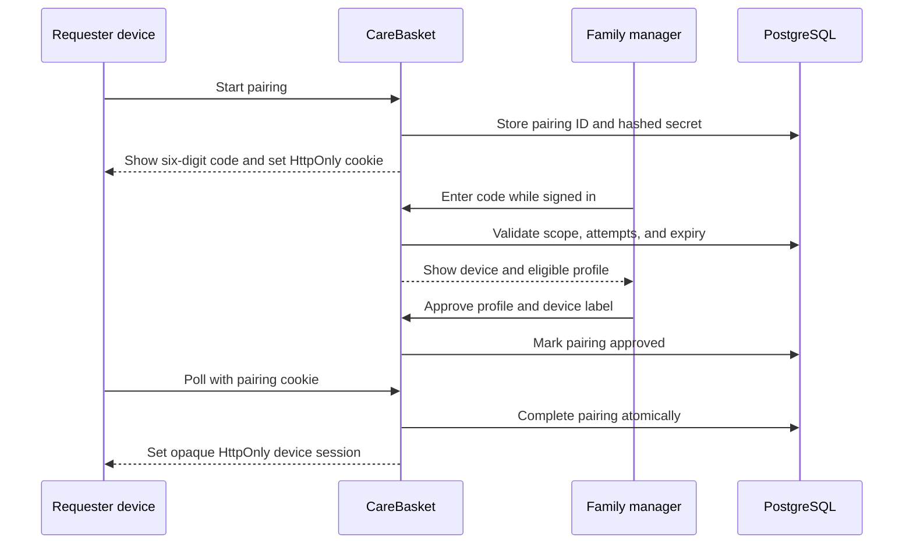
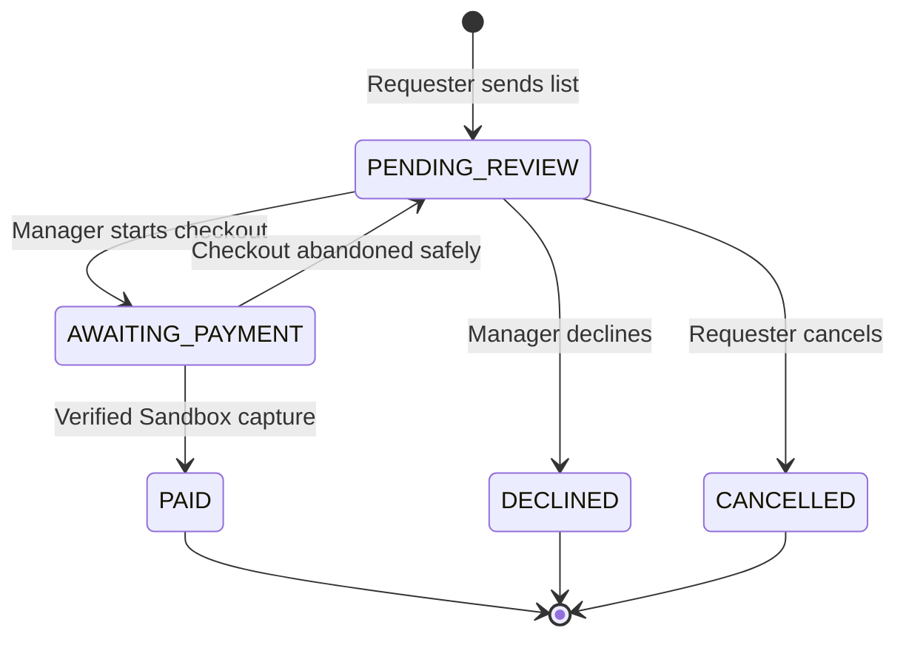
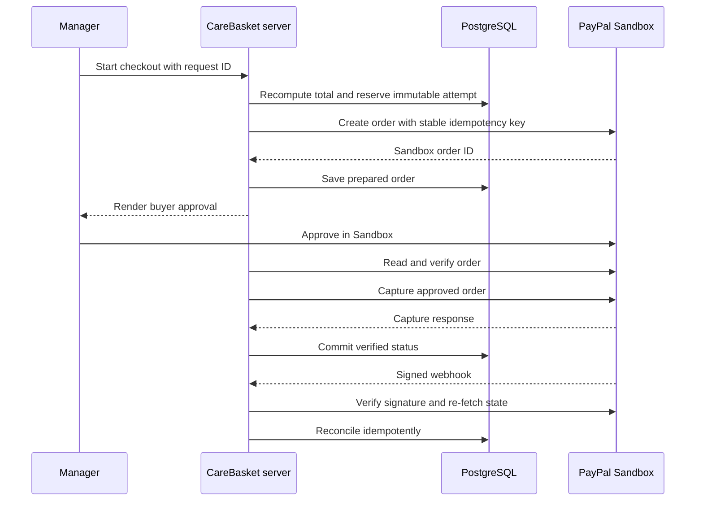
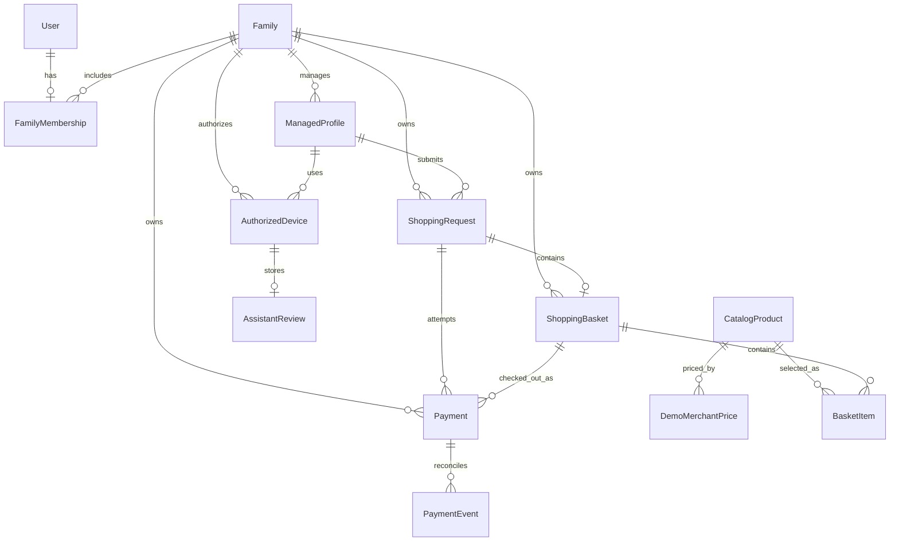

<div align="center">
  

  # CareBasket

  **A supervised AI shopping companion that turns an adult requester's words, voice, or picture choices into a family-reviewed grocery list.**

  [](https://nextjs.org/)
  [](https://react.dev/)
  [](https://www.typescriptlang.org/)
  [](https://developer.paypal.com/)
  [](https://ai.google.dev/gemini-api/docs)
  [](https://www.prisma.io/)
  [](LICENSE)

  [Live demo](https://care-basket.vercel.app/) · [Data sources](https://care-basket.vercel.app/data-sources) · [Privacy](https://care-basket.vercel.app/privacy) · [API contract](openapi/carebasket.openapi.yaml)
</div>

> [!IMPORTANT]
> CareBasket is an independent PayPal AI Hackathon 2026 prototype. It uses PayPal Sandbox, fictional CareBasket Demo Market prices, test identities, and simulated fulfillment. It does not place real grocery orders, arrange delivery, transfer real money, or represent an endorsement by PayPal, Google, or a retailer.

CareBasket reduces the distance between asking for essentials and getting trusted help. An adult requester can speak, type, or browse pictures; the CareBasket Shopping Guide converts that input into a catalog-grounded proposal; the requester confirms every item; and a trusted family manager reviews the submitted list before choosing whether to pay in PayPal Sandbox.

## Contents

- [Mission and vision](#mission-and-vision)
- [The problem](#the-problem)
- [How CareBasket works](#how-carebasket-works)
- [System architecture](#system-architecture)
- [The AI shopping agent](#the-ai-shopping-agent)
- [Text, voice, and picture shopping](#text-voice-and-picture-shopping)
- [Catalog and product images](#catalog-and-product-images)
- [Family management and pairing](#family-management-and-pairing)
- [Requests and manager review](#requests-and-manager-review)
- [PayPal Sandbox checkout](#paypal-sandbox-checkout)
- [Database design](#database-design)
- [Technology stack](#technology-stack)
- [Security and privacy](#security-and-privacy)
- [API, APIMatic, and Postman](#api-apimatic-and-postman)
- [Project structure](#project-structure)
- [Run locally](#run-locally)
- [Testing and release checks](#testing-and-release-checks)
- [Deployment](#deployment)
- [Known boundaries](#known-boundaries)
- [Contributing](#contributing)
- [License and attribution](#license-and-attribution)

## Mission and vision

### Mission

Help adults who find digital shopping difficult express what they need in a familiar way, while keeping a trusted person in control of review and payment.

### Vision

Make assisted commerce understandable, accountable, and accessible. CareBasket treats AI as a guide, not a buyer: it may interpret and propose, but people retain authority over the list, family access, and payment.

## The problem

Many shopping products assume that every user can search a large catalog, compare package sizes, understand checkout, and manage payment without help. That workflow can exclude older adults and other adults with limited confidence using technology. Asking a relative through an unstructured call or message can also lose quantities, product details, and accountability.

CareBasket separates the journey into two focused experiences:

| Person or system | Experience | Authority |
| --- | --- | --- |
| Adult requester | Voice, text, and picture-led shopping on an approved device | Builds and sends their own list |
| Family manager | Clerk-authenticated dashboard | Manages profiles and devices, reviews lists, decides whether to check out |
| CareBasket Shopping Guide | Catalog-grounded interpretation and suggestions | Proposes only; cannot edit, submit, approve, or pay |
| PayPal Sandbox | Buyer approval and payment-state verification | Confirms test payment state through signed provider responses |

The supported deployment is adults-only. New family and profile flows record an 18+ self-attestation and consent, but CareBasket does not claim to perform age verification.

## How CareBasket works

```mermaid
flowchart LR
    A[Manager signs in] --> B[Creates family and adult profile]
    B --> C[Approves requester device]
    C --> D{Requester input}
    D -->|Text| E[Interpret words]
    D -->|Voice| F[Interpret in-memory audio]
    D -->|Pictures| G[Browse reviewed catalog]
    E --> H[Review grounded proposal]
    F --> H
    G --> I[Build private draft]
    H --> I
    I --> J[Requester sends list]
    J --> K[Manager reviews items]
    K --> L{Manager decision}
    L -->|Decline| M[Close request]
    L -->|Checkout| N[Create Sandbox order]
    N --> O[PayPal buyer approval]
    O --> P[Verify capture and webhook state]
    P --> Q[Show test-payment result]
```



Each transition has a confirmation boundary. AI output has no business-state effect, adding an item requires a requester action, sending requires another requester action, and checkout requires a manager action plus PayPal buyer approval.

## System architecture

CareBasket follows a feature-oriented Next.js architecture. Routes assemble screens, features own business behavior, server modules enforce trust boundaries, and PostgreSQL stores authoritative state.



### Architectural rules

- `/family/*` resolves a Clerk-authenticated `OWNER` or `MANAGER` actor.
- `/shop/*` resolves an opaque database-backed session tied to one assisted-adult profile.
- Every service and repository receives server-derived actor scope. Client IDs are lookup keys, not authorization.
- Shared caching is limited to nonpersonal catalog data. Requests, reviews, families, and payments are never shared-cached.
- PostgreSQL is the source of truth for families, devices, requests, approved prices, and payment state.
- External catalog APIs run only in developer-operated curation scripts, never while a requester shops.

## The AI shopping agent

The agent is named **CareBasket Shopping Guide**. Its narrow purpose is to turn the current adult requester's words or in-memory voice recording into a validated proposal made only from the approved catalog.



### Agent authority

| Capability | Agent authority | Human or system authority |
| --- | --- | --- |
| Search and compare approved products | Read only | Application executes |
| Interpret the current request | Propose only | Requester confirms |
| Suggest quantity or substitution | Propose only | Requester confirms |
| Calculate prices or estimates | None | Application server |
| Change a draft or submit a list | None | Requester |
| Edit, approve, or decline a request | None | Family manager |
| Start checkout or capture payment | None | Manager and PayPal |
| Manage access or write catalog data | None | Manager or developer workflow |
| Read personal history or give regulated advice | None | Prohibited |

The provider may receive only the current request, a price-free approved catalog summary, `en-US`, and an assisted-adult audience marker. It does not receive names, ages, family details, history, prices, payment IDs, secrets, live inventory, retailer claims, or delivery promises.

The current deployment gate accepts the reviewed `gemini-3.5-flash-lite` configuration only. Voice remains unavailable unless the private feature flag, matching model, valid key, adult profile, and current per-profile AI consent are all present.

## Text, voice, and picture shopping

### Text

Typed requests are bounded, normalized, and validated. CareBasket can match text deterministically against catalog names and synonyms. When the approved Gemini gate is available, Gemini can produce structured interpretation and catalog-grounded suggestions; if that provider path fails, text keeps the deterministic fallback.

The review URL contains only an opaque ID. Its encrypted snapshot is device-bound, contains no audio or prices, and expires within 30 minutes or sooner if the signed proof expires.

### Voice

Voice starts only after the requester presses the speak control and grants microphone permission. The browser records a bounded clip and sends one multipart upload to `POST /api/assistant/voice`.

| Control | Implementation |
| --- | --- |
| Maximum audio size | 2 MiB |
| Accepted containers | WebM, Ogg, MP4/M4A, AAC, MPEG, WAV |
| Validation | Content type, byte limit, and container signature |
| Processing | In memory for one interpretation request |
| Persistence | Audio is never stored, logged, or cached |
| Access | Authorized assisted-adult device with current AI consent |
| Result | Private, signed, catalog-grounded proposal |

Voice failures leave text and picture selection available. A transcript remains untrusted until it passes schema validation and product grounding.

### Pictures

The products page offers a visual catalog without requiring Gemini. Search, category filters, cursor pagination, and automatic loading keep responses bounded while allowing continued browsing. Each card shows a reviewed image or category fallback, product name, package size, quantity controls, and an explicit add action.

## Catalog and product images

The committed U.S. catalog contains **150 reviewed demo products** across 11 categories, with **142 reviewed Cloudinary photo mappings** and eight category-icon fallbacks.

| Property | Rule |
| --- | --- |
| Sources | Open Food Facts, Open Prices, and manually curated essentials |
| Runtime | Seeded PostgreSQL catalog only |
| Categories | Produce, dairy and eggs, bakery, pantry, breakfast, meat and seafood, frozen, snacks, beverages, household, personal care |
| Prices | Approved fictional USD prices for CareBasket Demo Market |
| Images | Reviewed licensed assets under `care-based/products` on Cloudinary |
| Delivery | Next.js image optimization through the CareBasket origin |
| Review | Normalize, bound, deduplicate, license-check, and approve before seed |

Open Prices observations provide review evidence but never become a checkout price automatically. Shopping pages do not call Open Food Facts or Open Prices, which prevents external data changes from altering an active basket.

```text
discover candidates -> human review -> approve product and demo price
-> review image and license -> upload immutable image -> seed PostgreSQL
```

Catalog tooling is in [`scripts/catalog`](scripts/catalog), the dataset is [`prisma/catalog/catalog.us.json`](prisma/catalog/catalog.us.json), and image sources are recorded in [`public/products/ATTRIBUTION.md`](public/products/ATTRIBUTION.md).

## Family management and pairing

Managers authenticate through Clerk. Requesters do not need an email or password; they use a device approved for one assisted-adult profile.



Codes expire after 10 minutes and are rate-limited. Only hashes of device tokens and pairing secrets are stored. Production cookies use `__Host-`, `HttpOnly`, `Secure`, `SameSite=Lax`, and `Path=/`; managers can revoke device access.

## Requests and manager review

The requester draft stays client-side until send. Submission contains stable SKU, quantity, mode, and idempotency data; the server revalidates the catalog, applies approved prices, creates the request and basket, and prevents duplicates.

Managers receive a pending-request counter and searchable grid. The details page shows provenance, quantities, server-computed totals, and separate controls for editing, removing, declining, or checkout. Optimistic quantity changes give immediate feedback and roll back after server rejection.



Payment status and fulfillment remain separate. A verified payment does not mean delivery.

## PayPal Sandbox checkout

CareBasket uses **PayPal Orders v2**, the **PayPal JavaScript SDK v6** through `@paypal/react-paypal-js`, and **signed webhooks**. Every integration is locked to Sandbox.



### Payment integrity

- The browser sends a request ID, never a trusted amount, currency, family ID, or price.
- The server computes integer minor-unit totals from `DemoMerchantPrice` and validated quantities.
- Each attempt snapshots immutable lines and uses its UUID as the PayPal request-id key.
- Database fences serialize create, cancel, refresh, and capture work across serverless workers.
- Order ID, basket reference, payment custom ID, currency, and amount must match.
- Buyer approval is not confirmation. Only a verified completed capture marks the request paid.
- Webhooks verify raw bytes and PayPal transmission headers before business processing.
- Events are allowlisted, deduplicated by provider event ID, and reconciled with re-fetched state.
- No card data, OAuth token, payer profile, address, or full webhook body is stored.

`PAYPAL_BUYER_APPROVAL_ENABLED` is an explicit deployment control. Enabling it also requires a Sandbox webhook ID.

## Database design

CareBasket uses Prisma ORM 7 with PostgreSQL. The app uses a pooled Neon URL at runtime and a direct URL for migrations.



| Model | Responsibility | Boundary |
| --- | --- | --- |
| `User` | Clerk user mapping | No credentials |
| `Family` | Tenant root | Server-derived scope |
| `FamilyMembership` | OWNER or MANAGER role | One active family in the MVP |
| `ManagedProfile` | Adult profile, avatar, locale, consent | No birth date or profile photo |
| `DevicePairing` | Short-lived pairing | Hashes, attempts, expiry, state |
| `AuthorizedDevice` | Revocable requester session | Token hash and fixed profile scope |
| `AssistantReview` | Encrypted restorable proposal | One per device; no audio or prices |
| `CatalogProduct` | Product identity and presentation | Archived rather than erased from history |
| `DemoMerchantPrice` | Approved fictional USD price | Server-only total source |
| `ShoppingRequest` | Request input and lifecycle | Family and profile scoped |
| `ShoppingBasket` | Server-priced basket | One per request |
| `BasketItem` | Product, quantity, price, origin snapshots | Preserves historical meaning |
| `Payment` | Attempt, provider IDs, amount, operation fence | Unique order and capture IDs |
| `PaymentEvent` | Minimal reconciliation record | No full provider payload |
| `AuditLog` | Accountability events | No request text or secrets |
| `RateLimitCounter` | Fixed-window enforcement | Opaque or HMAC keys |

Eight migrations build family accounts, profiles, pairing, catalog, requests, private reviews, Sandbox payments, and payment events.

## Technology stack

| Layer | Technology | Use |
| --- | --- | --- |
| Web | Next.js 16.4, React 19.3 | App Router, Server Components, actions, handlers, streaming, images |
| Language | TypeScript 5 strict mode | Typed contracts and server boundaries |
| Identity | Clerk | Manager sign-in |
| Requester auth | Opaque device sessions | Passwordless, revocable, profile-bound access |
| AI | Google Gemini, `@google/genai` | Structured text and audio interpretation |
| Local assistant | Deterministic matcher | Text matching and fallback |
| Payments | PayPal Orders v2 and JS SDK v6 | Sandbox create, approval, capture, webhooks |
| Data | Prisma 7, PostgreSQL adapter, Neon | Typed persistence and migrations |
| Validation | Zod 4 | Inputs, environment, providers, stored JSON |
| Images | Cloudinary, Next.js Image | Licensed storage and optimized delivery |
| UI | CSS Modules, Hugeicons, AG Grid Community | Requester UI and manager data views |
| Testing | Vitest 4, Testing Library, jsdom | Unit, component, route, policy, repository tests |
| API tools | OpenAPI 3, APIMatic-ready contract, Postman | Documentation and boundary checks |
| Hosting | Vercel | HTTPS deployment and server functions |

## Security and privacy

### Security controls

- Every action, handler, and data read authenticates its actor independently.
- Family queries include server-derived `familyId`; requester queries also include `profileId`.
- Zod bounds inputs, IDs, numbers, environment, AI output, and provider responses.
- Cookie-authenticated mutations use action protections or exact-origin validation.
- PostgreSQL rate limits work across serverless instances.
- Device and pairing secrets are random, hashed, and absent from URLs and browser storage.
- Structured logs exclude names, shopping text, audio, tokens, cookies, and payload bodies.
- Credential modules are server-only; committed env templates contain no secrets.
- Security headers disable framing, MIME sniffing, camera, and geolocation, and restrict microphone use.
- Remote product images are limited to the configured Cloudinary account and folder.
- Client prices and unverified provider responses cannot mark a request paid.

### Privacy controls

| Data | Policy |
| --- | --- |
| Adult identity | Clerk stores sign-in identity; CareBasket stores its Clerk ID |
| Profile | Nickname, preset avatar, locale, consent metadata |
| Voice | In-memory processing; never stored |
| Text or transcript | Stored with a submitted request and subject to retention |
| AI review | Encrypted, device-bound, opaque ID, short-lived |
| Client IP | HMAC only for applicable rate limits |
| Payment | Provider IDs, amount, currency, status, minimal events |
| Tracking | No advertising, analytics, or session replay |

PayPal orders use `NO_SHIPPING`. Gemini receives only current input and price-free catalog context. Cloudinary stores licensed public product assets, never family data or recordings. Privacy requests can be sent to **kajugadaniels@gmail.com**; see the deployed [privacy notice](https://care-basket.vercel.app/privacy).

## API, APIMatic, and Postman

Application mutations use authenticated Server Actions. The OpenAPI contract documents three Route Handlers:

| Route | Purpose | Protection |
| --- | --- | --- |
| `GET /api/pairing/status` | Poll pairing state | Pairing cookie, rate limit, `no-store` |
| `POST /api/assistant/voice` | Interpret one audio upload | Device cookie, consent, origin, rate limit |
| `POST /api/webhooks/paypal` | Receive Sandbox events | Body limit, PayPal headers, signature verification |

[`openapi/carebasket.openapi.yaml`](openapi/carebasket.openapi.yaml) can be imported into [APIMatic](https://www.apimatic.io/) for contract validation or generated documentation. This does not create a second authentication path.

The [`postman`](postman) directory contains a secret-free collection and local environment. Its tests exercise negative boundaries such as missing device sessions and unsigned webhooks. Authentic successful webhooks must originate from PayPal Sandbox, while full authenticated journeys remain browser tests.

## Project structure

```text
care-basket/
├── openapi/                    # Route Handler contract
├── postman/                    # Secret-free API checks
├── prisma/
│   ├── catalog/                # Reviewed catalog and curation guide
│   ├── migrations/             # PostgreSQL migration history
│   ├── schema.prisma           # Models, relations, indexes
│   └── seed.ts                 # Offline catalog seed
├── public/                     # Landing media and product attribution
├── scripts/catalog/            # Discovery and image tooling
├── src/
│   ├── app/                    # Pages and HTTP handlers
│   ├── components/             # Shared UI
│   ├── features/               # Domain UI, actions, services, tests
│   ├── lib/                    # Providers, environment, utilities
│   ├── server/                 # Auth, DB, audit, rate limits, logs
│   ├── test/                   # Shared test setup
│   └── types/                  # Shared result contracts
├── .agents/                    # Engineering and security rules
├── next.config.ts              # Headers, images, Next.js features
├── prisma7.config.ts           # Prisma CLI environment and migrations
└── LICENSE                     # MIT application-source license
```

Features keep UI, copy, schemas, actions, services, repositories, and tests near the domain they own. Provider code stays behind server-only adapters.

## Run locally

### Prerequisites

- Node.js 22.13+ within Node 22, or 20.19+ within Node 20
- npm and the committed lockfile
- A dedicated PostgreSQL or Neon development database
- Clerk development credentials and a unique device auth secret
- Optional PayPal Sandbox, Gemini, and Cloudinary credentials

### 1. Install dependencies

```bash
npm ci
```

### 2. Create the local environment

```bash
cp .env.local.example .env.local
```

Fill `.env.local` from provider dashboards. Never commit it, paste it into an issue, or reuse production secrets.

| Group | Variables | Purpose |
| --- | --- | --- |
| App | `NEXT_PUBLIC_APP_URL` | Canonical origin |
| Clerk | publishable key, secret key, auth paths and redirects | Manager authentication |
| Database | `DATABASE_URL`, `DIRECT_URL` | Runtime and migrations |
| Device | `DEVICE_AUTH_SECRET`, `DEVICE_IP_SOURCE` | Sessions and rate-limit identity |
| Gemini | `GEMINI_API_KEY`, `GEMINI_MODEL`, `GEMINI_SHOPPING_ENABLED` | Consent-gated AI |
| PayPal | client IDs, secret, webhook ID, environment, approval flag | Sandbox checkout |
| Catalog | `CATALOG_USER_AGENT` | Developer discovery only |
| Cloudinary | cloud name; upload credentials and folder mode when needed | Images |
| Demo | `DEMO_FULFILLMENT_CONTROLS` | Simulated fulfillment |

The Gemini model must match [`src/lib/ai/eligibility.ts`](src/lib/ai/eligibility.ts). PayPal accepts Sandbox only, and public/server client IDs must identify the same app.

### 3. Generate, migrate, and seed

```bash
npx prisma generate --config prisma7.config.ts
npx prisma migrate dev --config prisma7.config.ts
npx prisma db seed --config prisma7.config.ts
```

Use `migrate dev` only on a development database. Prisma CLI reads `.env.local` unless `NODE_ENV=production`; runtime uses `DATABASE_URL`, while migrations use `DIRECT_URL`.

### 4. Start CareBasket

```bash
npm run dev
```

Open [http://localhost:3000](http://localhost:3000). Use fictional accounts and a second browser profile or device to test pairing.

For voice, configure a paid-tier Gemini key, reviewed model, enable flag, and profile consent. For checkout, configure a Sandbox REST app, business test account, personal buyer test account, and webhook targeting `/api/webhooks/paypal`.

## Testing and release checks

The repository contains **179 test files** covering validation, authorization, isolation, pairing, catalog curation, AI grounding, adversarial agent behavior, requests, payment concurrency, webhooks, accessibility, and UI behavior.

```bash
npm run lint
npx tsc --noEmit
npx vitest run
npm run build
```

Tests mock database and provider boundaries. They do not call live Clerk, Neon, Gemini, Cloudinary, or PayPal accounts, so passing tests do not prove a deployed provider journey.

Before release, use two browsers and verify:

1. Manager setup, adult consent, sign-in, and recovery.
2. Pairing, approval, persistence, expiry, and revocation.
3. Text, voice, pictures, quantity controls, and review restoration.
4. Explicit confirmation, idempotent submission, and requester status.
5. Manager notifications, filters, edits, decline, and rollback.
6. Sandbox order, approval, capture, webhook, refresh, and failure recovery.
7. Cross-family denial, revoked-device denial, direct URLs, keyboard, focus, and screen readers.
8. No personal data, secrets, audio, or payment payloads in logs.

The assistant release gate returns `HOLD` until automated checks, desktop/mobile journeys, isolation, Gemini text/voice, fallback, confirmation, manager boundaries, PayPal boundaries, and privacy review all have explicit passing evidence.

## Deployment

CareBasket targets Vercel with a separate Neon database and production provider configuration.

```bash
NODE_ENV=production npx prisma migrate deploy --config prisma7.config.ts
npm run build
```

The build generates Prisma Client before Next.js compilation. It does not migrate, seed, register webhooks, validate a real Gemini call, or prove browser behavior.

- Set secrets in Vercel, not by uploading `.env.production`.
- Keep the database and server functions regionally close.
- Use `DEVICE_IP_SOURCE=vercel` only with trusted Vercel ingress.
- Configure Clerk origins and redirects for the HTTPS domain.
- Register the PayPal Sandbox webhook and event types.
- Seed the catalog and redeploy or restart to invalidate its cache.
- Verify microphone permission, function duration, and the two-browser journey.

## Known boundaries

- Adults-only consent is self-attestation, not age verification.
- PayPal is Sandbox-only; production payments are out of scope.
- Products, prices, merchant, inventory, fulfillment, and delivery are simulated.
- The finite U.S. catalog does not promise every household item or current availability.
- Voice depends on browser support, permission, consent, eligibility, and provider availability.
- Text and pictures remain available without Gemini.
- Private reviews expire; drafts are not cross-device synchronization.
- Some deletion and retention work requires an accountable operator process.
- Source and automated tests do not replace accessibility or provider verification.

## Contributing

1. Read [`.agents/README.md`](.agents/README.md) and its topic rules.
2. Preserve requester, manager, AI, and payment authority boundaries.
3. Add or update tests beside the affected feature.
4. Run lint, strict type checking, the full suite, and production build.
5. Keep commits narrow and exclude secrets, generated clients, unreviewed reports, and real personal data.

Security-sensitive changes should document actor scope, validation, rate limits, retention, failure behavior, and verification.

## License and attribution

Application source is released under the [MIT License](LICENSE).

```text
Copyright (c) 2026 Daniels KAJUGA
```

MIT does not relicense datasets, images, fonts, packages, or other third-party materials:

- [`prisma/catalog/catalog.us.json`](prisma/catalog/catalog.us.json) is offered under [ODbL 1.0](https://opendatacommons.org/licenses/odbl/1-0/) with Open Food Facts, Open Prices, and CareBasket attribution.
- Individual source contents are covered by [DbCL 1.0](https://opendatacommons.org/licenses/dbcl/1-0/).
- Reviewed photos retain their recorded licenses, including CC BY-SA 3.0. See [`public/products/ATTRIBUTION.md`](public/products/ATTRIBUTION.md).
- Dependencies and fonts retain their own licenses.

## Acknowledgments

CareBasket builds on [Open Food Facts](https://world.openfoodfacts.org/), [Open Prices](https://prices.openfoodfacts.org/), PayPal Developer, Google Gemini, Clerk, Prisma, Neon, Cloudinary, Vercel, and its open-source dependencies.

<div align="center">

**CareBasket keeps AI helpful, family decisions human, and payment verifiable.**

</div>
